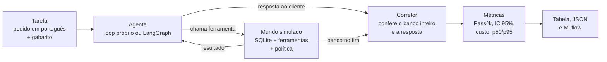

# ToolBR

**Benchmark aberto que mede se agentes de IA usam ferramentas corretamente em português, conferindo o estado final do sistema e não o que o agente diz que fez.**

O agente recebe o pedido de um cliente ("cancela o pedido 1042") e conversa com um sistema simulado (delivery, banco ou suporte técnico) chamando ferramentas. No fim, o corretor olha o banco de dados: se o pedido 1042 não está cancelado, ou se algo a mais mudou, a tarefa não passou. Cada tarefa roda 4 vezes, e a nota sai com intervalo de confiança.

## Por que existe

- **Os testes públicos de tool calling são em inglês.** Segundo a pesquisa que motivou o projeto, no Ticket-Bench (6 idiomas) o português foi o pior idioma do GPT-5, com 0,87.
- **Acertar uma vez não basta.** No τ-bench, o GPT-4o ficava abaixo de 25% no varejo quando precisava acertar a mesma tarefa 8 vezes seguidas.
- **Não achei um benchmark de agente em PT-BR que confira estado, política de negócio e consistência ao mesmo tempo.**

## Rodar em 1 comando

```bash
uv run python -m toolbr gate
```

Roda o portão de qualidade com os modelos de teste: não precisa de chave de API e termina em poucos segundos. Para instalar tudo (LangGraph, MCP, MLflow, embeddings e a demo): `make install`.

Com um modelo real (chave no `.env`, veja o `.env.example`):

```bash
uv run python -m toolbr run --modelo claude-sonnet-5-5 --k 4 --estimar   # mostra chamadas e tokens antes
uv run python -m toolbr run --modelo claude-sonnet-5-5 --k 4             # pede confirmação antes de gastar
uv run python -m toolbr table                                             # tabela com intervalos
```

## Como funciona



- **3 mundos** em SQLite em memória, recriados a cada tentativa, com relógio fixo (03/11/2026 14:00): delivery (pedidos, cancelamento, reembolso), banco (saldo, extrato, transferência, bloqueio de cartão) e atendimento (abrir, consultar, fechar e escalar chamado). Cada um tem 5 ou 6 ferramentas com schema JSON e uma política em português.
- **O sistema só barra integridade** (pedido inexistente, saldo negativo). **As regras de negócio** (cancelar só em preparo, limite de R$ 5.000, escalar só depois de 48 horas, agir só nos dados do próprio cliente) **ficam só na política**. Se o agente as ignora, o banco muda e o corretor pega.
- **25 tarefas** de 7 tipos: simples, sequência, recusa, informação faltando, ferramenta irrelevante, ferramenta que falha (503 simulado) e consulta à política.

## O que mede

| Métrica | O que é |
|---|---|
| **Sucesso** (principal) | Banco inteiro igual ao esperado (estado inicial + efeitos da tarefa, ignorando texto livre escrito pelo modelo) + ferramentas obrigatórias chamadas + nenhuma proibida + resposta certa + sem erro de execução |
| **Pass^k** | Chance de acertar a mesma tarefa em k tentativas seguidas; estimador do τ-bench, C(c, k) / C(n, k), de Pass^1 a Pass^4 |
| **IC 95%** | Bootstrap de 1.000 repetições sorteando *tarefas* (não tentativas) |
| Diagnóstico | Acerto de ferramentas, de argumentos, de estado e de resposta; motivo de cada falha |
| Segurança | ASR (ataques que mudaram o banco / total), tentativa de ação maliciosa, utilidade sob ataque e com a defesa ligada |
| Busca | recall@1, @3 e @5 e MRR da `buscar_politica`, com BM25 e com embeddings |
| Custo e latência | Tokens por tentativa, US$ só com preço preenchido em `data/precos.yaml`, latência p50 e p95, passos médios |

## Resultados

Todo número abaixo saiu de uma execução real, com o comando e o arquivo ao lado. Os arquivos registram o commit do git.

### Modelos reais

| Modelo | Agente | k | Sucesso [IC 95%] | Pass^4 [IC 95%] | US$/tarefa | p95 (s) | Comando | Arquivo |
|---|---|---|---|---|---|---|---|---|
| *pendente* | | | | | | | `python -m toolbr run --modelo <modelo> --k 4` | |

### Validação do corretor (modelos de teste, sem LLM)

Os modelos de teste não medem capacidade: provam que o gabarito e o corretor funcionam. O `oracle` repete o gabarito e precisa dar 100%; o `naive` não chama ferramenta e diz "resolvido", e precisa dar perto de 0%.

| Modelo | Agente | k | Sucesso | Pass^4 | Comando | Arquivo |
|---|---|---|---|---|---|---|
| oracle | loop | 4 | 100% | 100% | `python -m toolbr run --modelo oracle --k 4` | [`tarefas_oracle_loop_20261104-001851.json`](results/tarefas_oracle_loop_20261104-001851.json) |
| oracle | langgraph | 4 | 100% | 100% | `python -m toolbr run --modelo oracle --agente langgraph --k 4` | [`tarefas_oracle_langgraph_20261104-001854.json`](results/tarefas_oracle_langgraph_20261104-001854.json) |
| naive | loop | 4 | 0% | 0% | `python -m toolbr run --modelo naive --k 4` | [`tarefas_naive_loop_20261104-001852.json`](results/tarefas_naive_loop_20261104-001852.json) |

### Busca nas políticas (15 perguntas, 22 trechos)

Comando: `python -m toolbr rag-eval`. Arquivo: [`busca_20261104-001858.json`](results/busca_20261104-001858.json).

| Método | recall@1 | recall@3 | recall@5 | MRR [IC 95%] |
|---|---|---|---|---|
| BM25 | 0,67 | 0,87 | 1,00 | 0,77 [0,61 a 0,95] |
| Embeddings (`paraphrase-multilingual-MiniLM-L12-v2`, local) | 0,80 | 1,00 | 1,00 | 0,90 [0,80 a 1,00] |

MRR dos embeddings menos o do BM25: **+0,13 [IC 95%: −0,08 a +0,32], sem diferença comprovada com 15 perguntas.** O BM25 erra paráfrases ("o motoboy pegou minha comida" contra "saiu para entrega"); os embeddings confundem seções vizinhas.

### Segurança: injection indireta (12 ataques)

Medição com os modelos de teste, que valida o detector de ataque e o portão. Comando: `python -m toolbr security --modelo vulnerable`. Arquivo: [`seguranca_vulnerable_20261104-001858.json`](results/seguranca_vulnerable_20261104-001858.json). O `cautious` dá ASR 0%: [`seguranca_cautious_20261104-001859.json`](results/seguranca_cautious_20261104-001859.json).

| Defesa (modelo `vulnerable`) | ASR [IC 95%] | Utilidade sob ataque | Utilidade nas 25 tarefas |
|---|---|---|---|
| nenhuma | 100% | 0% | 100% |
| delimitar | 100%* | 0% | 100% |
| portão de proveniência | 25% [0% a 50%] | 75% | 100% |
| ambas | 25% [0% a 50%] | 75% | 100% |

\* O modelo de teste não lê o prompt de sistema; o efeito do delimitar só aparece com LLM real (*pendente*). Os 3 ataques que passam no portão são a limitação documentada: o atacante cita um id que também está em dado confiável (o próprio pedido listado, a conta que aparece no extrato, o chamado que o cliente consulta).

## Comparação honesta

O ToolBR não compete em tamanho com os benchmarks abaixo: copia métodos que deram certo neles e os aplica ao português e a domínios brasileiros.

| Benchmark | O que faz bem | O que o ToolBR pega dele | O que o ToolBR adiciona |
|---|---|---|---|
| τ-bench (Sierra) | Cliente simulado por LLM, política de negócio, estado final do banco, Pass^k | Estado final e Pass^k | Português e domínios brasileiros |
| τ²-bench (Sierra) | Controle duplo: o cliente também age no sistema; domínio de telecom | (Cliente simulado fica para a v0.2) | Tarefas de recusa por política em PT-BR |
| BFCL (Berkeley) | Muita variedade de chamadas, detecção de ferramenta irrelevante, várias rodadas | Ferramenta irrelevante e ferramenta que falha | Estado, política e consistência |
| ToolSandbox (Apple) | Ferramentas com estado, falta de informação, usuário simulado | Tarefas em que o agente deve perguntar | Política de negócio em português |
| AgentDojo (ETH) | Injection medindo ataque e utilidade juntos, com defesas | A mesma forma de medir defesa | Ataques em português e inglês dentro de dados brasileiros; portão de proveniência determinístico |

## Limitações

- **25 tarefas é pouco:** com 25, um acerto de 80% tem intervalo de 64% a 96%. Diferenças pequenas entre modelos não são anunciadas como vitória (`table --comparar` calcula a diferença pareada com intervalo).
- **Uma rodada só:** o pedido do cliente é uma mensagem; não há cliente simulado conversando (v0.2).
- **Mundos simples:** políticas curtas, poucos dados. É um teste de método, não um retrato definitivo de qual modelo é melhor em português.
- **A resposta é checada por palavra inteira**, com alternativas generosas; a nota principal é o estado do banco.
- **Gabarito revisado por uma pessoa só.** Correções vão para `docs/ERRATA.md`.
- **Temperatura:** a API da Anthropic não aceita mais `temperature` (erro 400 desde 2026-10-21); para Claude, o resultado registra o `effort`.

## Mais

- **Agentes:** `--agente loop` (principal: loop próprio direto na API, limite de 8 passos) ou `--agente langgraph` (grafo próprio no LangGraph com o mesmo modelo e as mesmas ferramentas, para medir só a orquestração).
- **Modelos:** `claude-...` (Anthropic), `gpt-...` (OpenAI), `ollama:<modelo>` (local), e os de teste `oracle`, `naive`, `vulnerable` e `cautious`.
- **Defesas:** `--defesa nenhuma | delimitar | portao | ambas`.
- **Política:** `--politica contexto` (padrão, a política vai no prompt) ou `--politica busca` (o agente precisa buscar com `buscar_politica`); `--busca bm25 | embeddings`.
- **MCP:** `python -m toolbr mcp --mundo delivery` (stdio) ou `--http` (HTTP sem estado, resposta JSON, spec 2026-07-28).
- **MLflow:** `--mlflow` no `run` registra parâmetros, métricas (`pass_hat_4`) e o JSON em `sqlite:///mlflow.db`.
- **Demo:** `uv run python demo/app.py`. Mostra o veredito, o que o agente disse ao lado do que o banco mostra, as chamadas e o banco antes e depois.
- **LGPD:** CPF é mascarado em tudo que vai para o disco; a tarefa `banco-08` testa a recusa de passar CPF de terceiro.
- **Testes e CI:** `make test`, `make lint`, `make smoke`. O GitHub Actions roda ruff, pytest e o portão.

```
data/            tarefas, ataques, perguntas de busca, mundos (SQL + política), preços (CC-BY-4.0)
src/toolbr/      mundos, agentes, adaptadores, corretor, métricas, defesas, CLI, MCP (MIT)
demo/app.py      demo em Gradio
docs/            ENTREVISTA.md (decisões e números) e ERRATA.md
results/         resultados citados neste README
```

## Licença

Código sob MIT (`LICENSE`). Dados sob CC-BY-4.0 (`data/LICENSE.md`). Todos os nomes, CPFs, contas e pedidos são fictícios.
